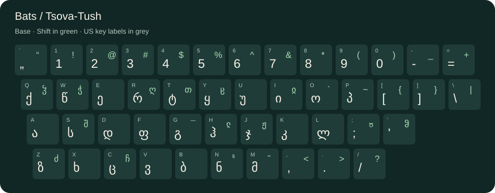

# Bats / Tsova-Tush keyboard

An extended Georgian keyboard layout for typing Bats / Tsova-Tush on macOS, originally created with [Ukelele](https://software.sil.org/ukelele/).

**[Download the latest release](https://github.com/kkahadze/bats-keyboard/releases/latest)** · [Layout image](docs/layout.svg) · [Changelog](CHANGELOG.md)



## Installation

No installer, Python, or Ukelele is needed to use the keyboard.

1. Download `Bats-<version>.zip` from the [latest release](https://github.com/kkahadze/bats-keyboard/releases/latest) and double-click it to extract it.
2. In Finder, choose **Go → Go to Folder…** (`Shift–Command–G`) and enter `~/Library/Keyboard Layouts/`. If the folder does not exist, open `~/Library/` and create a folder named `Keyboard Layouts`.
3. Copy **`Bats.bundle`** from the extracted folder into `Keyboard Layouts`. Copy the whole bundle, not its individual contents. This installs it for your account.
4. Save your work, then **log out and log back in** so macOS discovers the layout.
5. Open **System Settings → Keyboard → Text Input → Edit…**, click **+**, and look for **Bats**. If a search does not find it, browse **Others** or the Georgian language group. Select it and click **Add**. On older macOS versions, use **System Preferences → Keyboard → Input Sources**.
6. Select **Bats** from the input menu in the menu bar. Enable “Show Input menu in menu bar” if needed.

These steps follow the [Apple input-source settings guide](https://support.apple.com/guide/mac-help/mchl84525d76/mac) and the [Ukelele manual’s installation guidance](https://software.sil.org/ukelele/). The bundle is a data-only macOS keyboard layout; it does not include an executable installer.

### Check that it works

Open TextEdit, select Bats, and press the physical **A**, **S**, and **D** keys on a US-labelled keyboard. You should see **ა**, **ს**, and **დ**. Use macOS **Keyboard Viewer** to inspect the active layout while holding modifiers. Keep another input source available so you can switch back easily.

### Explore the layout

Open **`docs/index.html`** from the downloaded release in any modern browser. It works offline and includes:

- All nine modifier layers, including Shift, Option, Caps Lock, Command, and Control combinations.
- Standard and Japanese hardware mappings, including inherited outputs.
- A full key-code reference with Unicode values and control characters.
- A keyboard diagram that scrolls horizontally on phones.

Some original modifier mappings have empty outputs: the preview shows these as `∅`, and missing mappings as `—`. The diagram uses ANSI positions and US key labels for orientation. ISO and JIS keyboards have different physical shapes; their extra keys appear in the full reference. The selector labels summarize the layer groups; exact modifier combinations are defined in `Bats.keylayout` under `modifierMap`. The preview is a reference, not a virtual keyboard or an installation test.

### Update or remove

To update, switch to another input source, replace the existing `~/Library/Keyboard Layouts/Bats.bundle` with the new release, then log out and back in. Keep only one copy of the Bats bundle across your user and system Keyboard Layouts folders.

To remove, switch to another input source, remove Bats from Keyboard settings, move `~/Library/Keyboard Layouts/Bats.bundle` to Trash, then log out and back in.

### Troubleshooting and compatibility

- **Bats is missing:** confirm the bundle is directly inside `~/Library/Keyboard Layouts/`, not nested inside the release folder. Log out and back in; restart if the input-source list remains stale.
- **Characters appear as boxes:** try TextEdit with a font supporting Georgian script. Glyph coverage varies by font and application.
- **Outputs differ from the diagram:** confirm Bats is selected, check Caps Lock and modifiers, and select the matching hardware mapping in the preview.
- **Windows, Linux, iOS, or Android:** this macOS `.bundle` is not an input method for those platforms. The preview can still be viewed there.

Automated checks validate the bundle metadata, map references, generated preview, and release archive. They do **not** prove that macOS has activated the input source. Native activation and typing still need a manual check on the target Mac; no minimum macOS version is currently certified.

## Verify a download

Download `SHA256SUMS.txt` alongside the ZIP. In Terminal, open the folder containing both files and run:

```sh
shasum -a 256 -c SHA256SUMS.txt
```

The checksum detects a corrupted or mismatched download; it is not a signing certificate.

## Development

Python **3.10 or newer**, standard library only:

```sh
python3 scripts/build.py                 # validate and regenerate docs/
python3 scripts/build.py --check         # fail if generated files are stale
python3 -m unittest discover -s tests -v
python3 scripts/build.py --check --package
```

The last command writes `dist/Bats-<version>.zip` and `dist/SHA256SUMS.txt`. The ZIP includes the bundle, README, changelog, and offline preview. It uses fixed archive timestamps and file permissions for repeatable builds in the same toolchain.

Edit the source layout in Ukelele or carefully edit its XML, then regenerate the preview. The XML is version 1.1 and includes valid control-character references that some XML 1.0 parsers reject; the build script handles these in memory without rewriting the keyboard file. Preview presentation lives in `scripts/preview.html`; do not edit the generated `docs/index.html` directly.

### Releases

1. Update `CFBundleVersion` and `CFBundleShortVersionString` in `Bats.bundle/Contents/Info.plist`, and `BuildVersion` and `SourceVersion` in `Bats.bundle/Contents/version.plist` to the same `MAJOR.MINOR.PATCH` version.
2. Update `CHANGELOG.md`, regenerate the preview, run the checks above, and commit.
3. Push a matching `vMAJOR.MINOR.PATCH` tag. The release workflow validates the tag against the bundle, tests the package, and publishes the ZIP and checksum as a GitHub release. Only tag a reviewed commit.

Pull requests and pushes to `main` run validation on Linux and macOS. Releases use Python 3.12 on Linux for a consistent packaging environment.

## Project status

Version 1.0.0 packages the original character mappings with documentation, previews, and release automation. Linguistic changes should be reviewed by Bats speakers; this release does not claim a linguistic audit.
